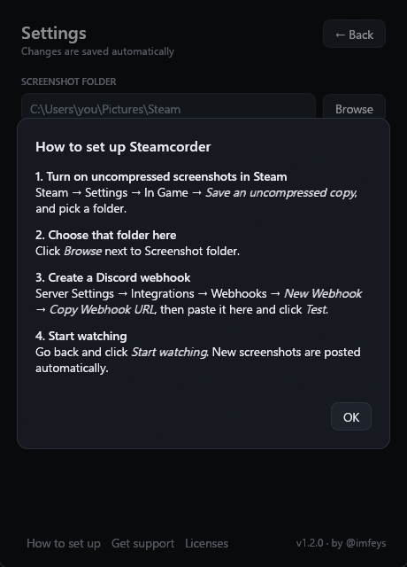

<p align="center">
  
</p>

<h1 align="center">Steamcorder</h1>

<p align="center">
  <strong>Your Steam screenshots, posted to Discord automatically.</strong><br>
  Press F12 in any game. A few seconds later it's in your server's <code>#screenshots</code> channel.
</p>

<p align="center">
  <a href="https://github.com/imfeys/Steamcorder/releases/latest/download/Steamcorder.exe"></a>
</p>

<p align="center">
  <a href="https://github.com/imfeys/Steamcorder/releases/latest"></a>
  <a href="https://github.com/imfeys/Steamcorder/releases"></a>
  
  
  <a href="LICENSE"></a>
</p>

<p align="center">
  
  
  
</p>

**Steamcorder** is a free Windows app that shares your Steam screenshots to a Discord channel. It uses a Discord webhook, so there's no bot to invite, nothing to upload by hand, and nothing to install: it's a single ~10 MB `.exe`.

It's made for gaming communities, friend groups and clan servers that want a shared screenshots channel that fills itself.

## Features

- **Automatic Steam → Discord uploads.** Watches your screenshot folder and posts every new image.
- **No bot needed.** Paste one Discord webhook URL and click *Test* to check it works.
- **Runs quietly in the tray** and can **start with Windows**.
- **Reliable.** Waits until each file is fully saved, and retries when Discord is busy or rate-limits.
- **Optional cleanup.** Delete screenshots after they're uploaded.
- **Any image, any tool.** PNG, JPG, GIF, BMP and WebP, from Steam, ShareX, Xbox Game Bar, NVIDIA and others.

## What's new in 1.2

Steamcorder has been rewritten from the ground up in **Rust**.

- **One small file.** A single 10 MB `Steamcorder.exe` replaces the old 127 MB bundle of Python and Qt files.
- **Same app you know.** Same look, same options, and your existing settings carry over automatically.
- **Native Windows tray icon**, and opening Steamcorder a second time simply brings the running window to the front.

## Download

1. Download **[Steamcorder.exe](https://github.com/imfeys/Steamcorder/releases/latest/download/Steamcorder.exe)** from the [latest release](https://github.com/imfeys/Steamcorder/releases/latest).
2. Put it anywhere you like (for example a `Steamcorder` folder in Documents) and double-click it.

> **Windows SmartScreen** may warn you because the app isn't code-signed yet. Click **More info → Run anyway**.

Requires Windows 10 or 11 (64-bit).

## Setup (2 minutes)

1. **Turn on uncompressed screenshots in Steam.**
   Steam → Settings → In Game → enable *Save an uncompressed copy of my screenshots* and pick a folder.
2. **Choose that folder in Steamcorder.**
   Settings → *Browse*.
3. **Create a Discord webhook.**
   In Discord: Server Settings → Integrations → Webhooks → *New Webhook* → *Copy Webhook URL*.
   Paste it into Steamcorder and click *Test*.
4. **Click _Start watching_.** That's it.

Settings save automatically. Steamcorder remembers whether it was watching and picks up where it left off next time. The same steps are in the app under Settings → *How to set up*.

## Options

| Option | What it does |
| --- | --- |
| Upload delay | Extra wait after a screenshot is saved, before it's posted (0–30 seconds). |
| Delete screenshots after uploading | Removes the local file once Discord has it. |
| Keep running in the tray when closed | Closing the window hides it to the tray instead of quitting. |
| Start with Windows | Launches quietly in the tray when you sign in. |

Settings are stored in `%APPDATA%\Steamcorder\config.json`.

**Large screenshots:** Discord limits upload size per server (10 MB without boosts). Uncompressed 4K PNGs can exceed that. If one does, Steamcorder tells you in the activity list.

## FAQ

### How do I automatically send Steam screenshots to Discord?
Run Steamcorder, point it at your Steam screenshot folder, paste a Discord webhook URL and click *Start watching*. Every F12 screenshot is then posted to that channel.

### Does it need a Discord bot?
No. It uses a standard Discord webhook, which any server admin can create in about 30 seconds.

### Where does Steam save screenshots?
Steam stores compressed copies under `Steam\userdata\<id>\760\remote`. Steamcorder uses the *uncompressed copy* folder you pick under Steam → Settings → In Game, which is easier to find and gives full quality.

### Does it work with non-Steam screenshots?
Yes. It uploads any new image saved to the folder you choose, whether it comes from ShareX, the Xbox Game Bar, NVIDIA or anything else.

### Is it safe?
Yes. It only reads the one folder you choose and only talks to the Discord webhook you provide. Nothing else is collected or sent anywhere.

### I'm upgrading from an older version. Do I need to set it up again?
No. Version 1.2 reads the same settings file, so your folder, webhook and options are kept.

### How do I uninstall it?
Turn off *Start with Windows*, quit it from the tray icon, then delete `Steamcorder.exe` and the `%APPDATA%\Steamcorder` folder.

## Building from source (maintainer)

Needs the [Rust toolchain](https://rustup.rs) and the MSVC C++ build tools.

```powershell
cargo test
cargo build --release
```

The exe is written to `target\release\Steamcorder.exe`. `build.bat` runs both steps and copies it to `dist\`.

**Releasing:** open **Actions → Build exe → Run workflow** and enter a version such as `1.2.0`, or push a tag like `v1.2.0`. The workflow checks formatting, runs clippy and the tests, builds `Steamcorder.exe` and publishes the release.

## Support

Questions or bugs: [Discord](https://discord.gg/dMvCH93sYX) or [GitHub Issues](https://github.com/imfeys/Steamcorder/issues).

## License

Copyright © imfeys. All rights reserved. Steamcorder is proprietary software: see [LICENSE](LICENSE). It is built with open-source components listed in [THIRD_PARTY_NOTICES.md](THIRD_PARTY_NOTICES.md).
