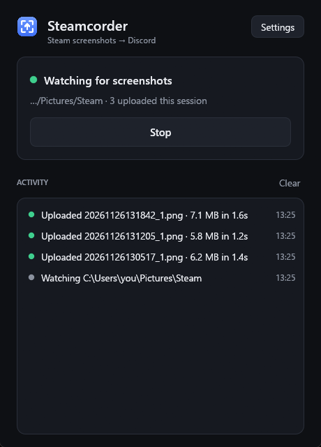
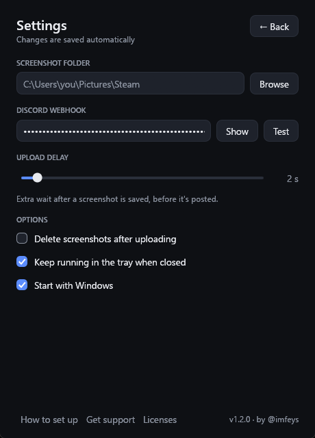

# Steamcorder: Auto-Upload Steam Screenshots to Discord

**Steamcorder** is a free Windows app that **automatically shares your Steam screenshots to a Discord channel**. Press F12 in any Steam game and the screenshot is posted to your Discord server through a webhook a few seconds later. No bot, no manual uploading, and no Python install: it's one `.exe`.

It's built for gaming communities, friend groups and clan servers that want a shared `#screenshots` channel that fills itself.

  
  

## Features

- **Automatic Steam → Discord uploads**: watches your Steam screenshot folder and posts every new screenshot.
- **Discord webhooks**: no bot account or server permissions to set up; paste one URL.
- **Runs quietly in the tray** and can **start with Windows**.
- **Reliable**: waits until each file is fully saved and retries when Discord rate-limits.
- **Optional cleanup**: delete screenshots after they're uploaded.
- **Supports PNG, JPG, GIF, BMP and WebP.**

## Download

Get **`Steamcorder.exe`** from the [latest release](https://github.com/imfeys/Steamcorder/releases/latest) and double-click it.

> Windows SmartScreen may warn you because the app isn't code-signed. Click **More info → Run anyway**.

## Setup (2 minutes)

1. **Turn on uncompressed screenshots in Steam.**
   Steam → Settings → In Game → enable *Save an uncompressed copy of my screenshots* and pick a folder.
2. **Choose that folder in Steamcorder.**
   Settings → *Browse*.
3. **Create a Discord webhook.**
   In Discord: Server Settings → Integrations → Webhooks → *New Webhook* → *Copy Webhook URL*.
   Paste it into Steamcorder and click *Test*.
4. **Click _Start watching_.** That's it.

Settings save automatically. Steamcorder remembers whether it was watching and picks up where it left off next time.

## Options

| Option | What it does |
| --- | --- |
| Upload delay | Extra wait after a screenshot is saved, before it's posted. |
| Delete after uploading | Removes the local file once Discord has it. |
| Keep running in the tray | Closing the window hides it to the tray instead of quitting. |
| Start with Windows | Launches quietly in the tray when you sign in. |

Settings are stored in `%APPDATA%\Steamcorder\config.json`.

**Large screenshots:** Discord limits upload size per server (10 MB without boosts). Uncompressed 4K PNGs can exceed that. If one does, Steamcorder tells you in the activity list.

## FAQ

### How do I automatically send Steam screenshots to Discord?
Install Steamcorder, point it at your Steam screenshot folder, paste a Discord webhook URL and click *Start watching*. Every F12 screenshot is then posted to that channel.

### Does it need a Discord bot?
No. It uses a standard Discord webhook, which any server admin can create in about 30 seconds.

### Where does Steam save screenshots?
Steam stores compressed copies under `Steam\userdata\<id>\760\remote`. Steamcorder uses the *uncompressed copy* folder you pick under Steam → Settings → In Game, which is easier to find and gives full quality.

### Does it work with non-Steam screenshots?
Yes. It uploads any new image saved to the folder you choose, whether it comes from ShareX, the Xbox Game Bar, NVIDIA or anything else.

### Is it safe?
Yes. It only reads the one folder you choose and only talks to the Discord webhook you provide. Nothing else is collected or sent anywhere.

## Releasing (maintainer)

Open **Actions → Build exe → Run workflow** and enter a version such as `1.1.0`. This builds `Steamcorder.exe` and publishes the release. Run `build.bat` to build locally (needs the Rust toolchain from https://rustup.rs and the MSVC C++ build tools).

## Support

Questions or bugs: [Discord](https://discord.gg/dMvCH93sYX) or [GitHub Issues](https://github.com/imfeys/Steamcorder/issues).

## License

Copyright © imfeys. All rights reserved. Steamcorder is proprietary software: see [LICENSE](LICENSE). It bundles open-source components listed in [THIRD_PARTY_NOTICES.md](THIRD_PARTY_NOTICES.md).
